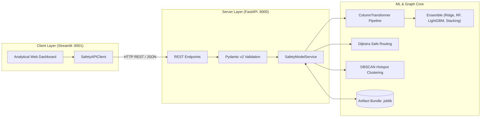

# Urban Safety Analytics & Safe Routing Platform

A distributed Machine Learning and spatial analytics platform for urban safety assessment, incident hotspot detection, and risk-aware route optimization (modeled on Lviv, Ukraine). The system separates the **FastAPI** ML & graph backend from the interactive **Streamlit** web dashboard.

## System Architecture



## Core Functionality

* **Sector Risk Assessment:** Predicts spatio-temporal risk scores (`0–100`) using **Ridge**, **Random Forest**, **LightGBM**, and a **Stacking Ensemble**.
* **Safe Path Optimization:** Finds safety-weighted routes across Lviv's road graph using **Dijkstra's algorithm**.
* **Hotspot Detection:** Identifies dense incident clusters automatically via **DBSCAN** with Haversine distance.
* **What-If Simulation & Batch Audit:** Simulates lighting/CCTV upgrades and processes bulk patrol point CSV files.

## Project Structure

```text
urban-safety-analytics/
├── api/                  # FastAPI REST endpoints and Pydantic v2 validation schemas
├── core/                 # ML pipelines, DBSCAN clustering, and NetworkX routing
├── scripts/              # Synthetic dataset generator
├── streamlit_app/        # Interactive 5-module analytical dashboard
├── tests/                # Automated Pytest suite
├── requirements.txt      # Project dependencies
└── README.md             # Project documentation
```

## Setup & Running

**1. Clone and install dependencies (Python 3.11+):**

```bash
git clone [https://github.com/lilianablashchuk/urban-safety-analytics.git]
cd urban-safety-analytics
python -m venv .venv
.venv\Scripts\activate          # Linux/macOS: source .venv/bin/activate
pip install -r requirements.txt
```

**2. Generate dataset and run tests:**

```bash
python -m scripts.generate_dataset
pytest
```

**3. Start the services (in two separate terminals):**

```bash
# Terminal 1: FastAPI Backend (http://localhost:8000/docs)
uvicorn api.main:app --port 8000 --reload

# Terminal 2: Streamlit Dashboard (http://localhost:8501)
streamlit run streamlit_app/app.py
```